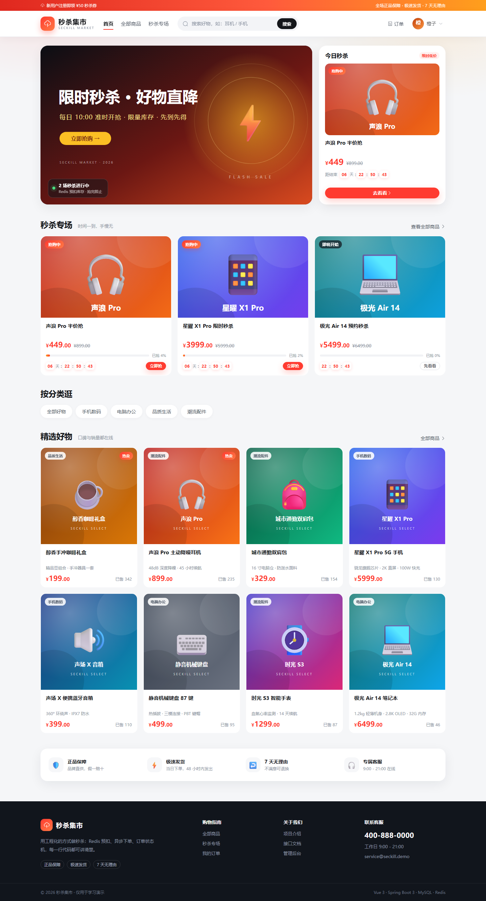
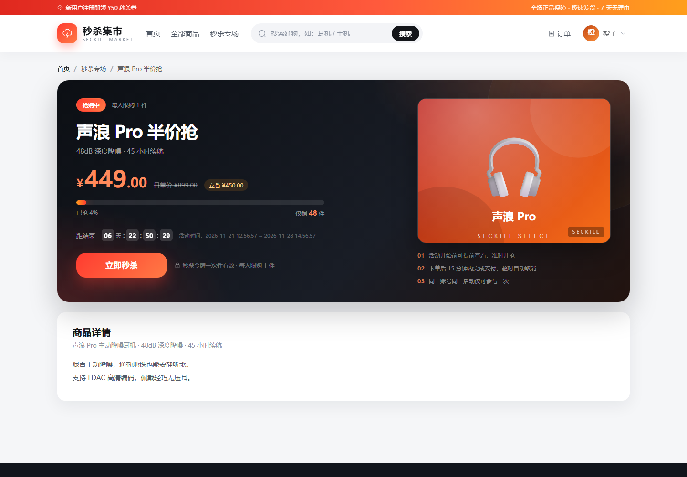
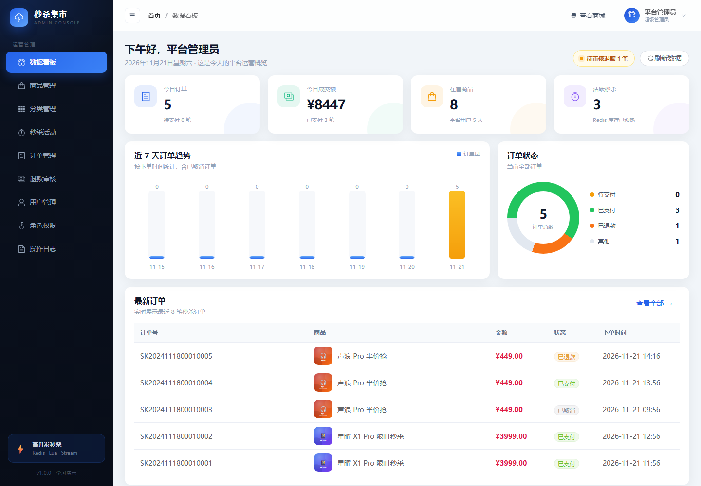
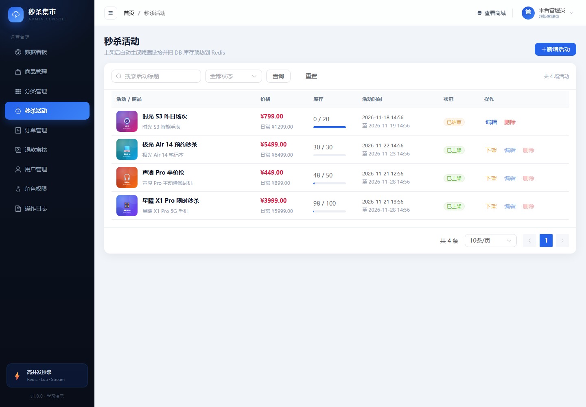
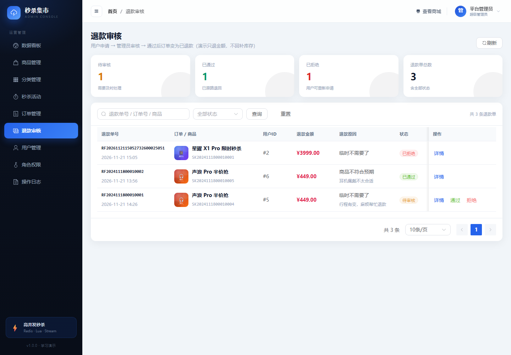
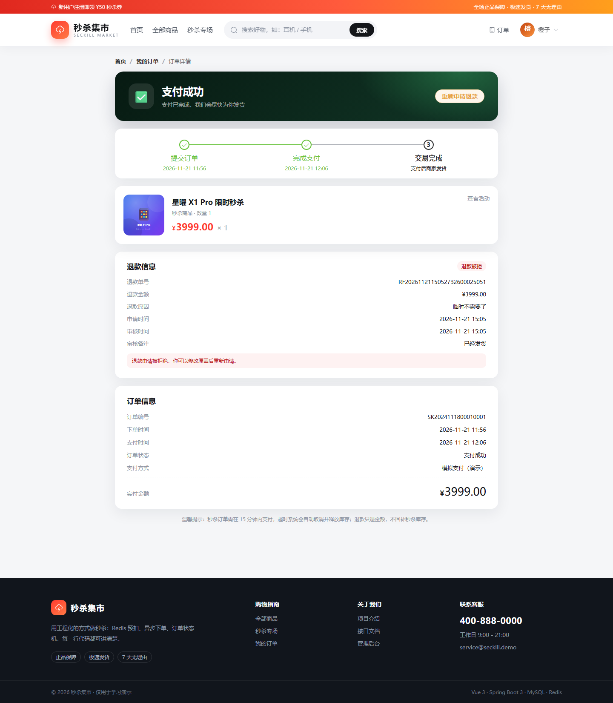

# 秒杀集市（Seckill Platform）

一个可以直接写进简历、也能用来系统练习 Java 后端阶段一 / 阶段二知识点的**电商秒杀项目**。

- **用户端**：商品浏览、秒杀抢购、订单支付/取消、申请退款、个人中心
- **管理端**：数据看板、商品/分类、秒杀活动、订单、退款审核、用户、RBAC 角色权限、操作日志
- **后端**：Spring Boot 3 + MyBatis-Plus + MySQL + Redis + Redisson
- **前端**：Vue 3 + Vite 4 + Element Plus（两个独立应用）

> 项目位置：`E:\seckill-platform`

---

## 1. 技术栈

| 层 | 选型 |
|---|---|
| 后端 | Java 17、Spring Boot 3.3.5、MyBatis-Plus 3.5.9 |
| 数据库 | MySQL 8.0（启动时自动建库、建表、灌演示数据） |
| 缓存/并发 | Redis 5+、Lettuce、Redisson、Lua 脚本、Redis Stream |
| 鉴权 | JWT（jjwt 0.12.6）+ 拦截器 + BCrypt |
| 工具 | EasyExcel 4、springdoc-openapi 2.6 |
| 前端 | Vue 3.4、Vite 4.5、Element Plus 2.8、Pinia、Axios |

---

## 2. 目录结构

```
E:\seckill-platform
├─ backend/                 Spring Boot 后端（端口 9090）
│  ├─ src/main/java/com/seckill
│  │  ├─ common/            统一响应、异常、JWT、拦截器、限流切面、操作日志切面
│  │  ├─ auth/              登录注册、个人中心
│  │  ├─ system/            用户、角色、权限、操作日志、工作台
│  │  ├─ product/           商品、分类、缓存三件套
│  │  ├─ seckill/           秒杀活动、Lua 预扣、Redis Stream 下单、订单状态机
│  │  ├─ upload/            图片上传
│  │  ├─ seed/              首次启动初始化演示数据
│  │  └─ job/               超时关单、活动到期、DB 兜底任务
│  └─ src/main/resources
│     ├─ schema.sql         幂等建表脚本
│     ├─ lua/               预扣库存 / 回滚库存 Lua
│     └─ application.yml
├─ mall-web/                用户端 Vue（端口 5180）
├─ admin-web/               管理端 Vue（端口 5181）
├─ uploads/seed/            本地商品图 / 头像 / Banner（SVG，离线可用）
├─ db/                      预留 SQL 目录
├─ docs/                    学习路线、接口说明、秒杀链路、截图
├─ scripts/                 启动脚本、冒烟/压测脚本、素材生成、截图脚本
└─ README.md
```

---

## 3. 快速启动

### 3.1 前置条件

- JDK 17+
- Maven 3.9+
- Node.js 16+（Vite 4 兼容 Node 16）
- MySQL 8.x 已启动（默认 3306）
- Redis 已启动（默认 6379，无密码）

### 3.2 启动 Redis

本机已安装在 `D:\Redis`，可直接双击：

```bat
scripts\start-redis.bat
```

或命令行：

```bat
D:\Redis\redis-server.exe D:\Redis\redis.windows.conf
```

### 3.3 启动后端

```bat
cd E:\seckill-platform\backend
set DB_PASSWORD=你的MySQL密码
mvn spring-boot:run
```

- 后端地址：`http://localhost:9090`
- Swagger：`http://localhost:9090/swagger-ui.html`
- 首次启动会自动：
  1. 创建数据库 `seckill_platform`
  2. 执行 `schema.sql` 建表（`IF NOT EXISTS`，可重复启动）
  3. 初始化演示数据（仅当 `sys_user` 为空）
  4. 预热进行中活动的 Redis 库存与隐藏链接

> 默认端口使用 **9090**，避免和本机已占用的 8080 冲突。
> 也可以用 `scripts\start-backend.bat`，把密码写在脚本里或设置系统环境变量 `DB_PASSWORD`。

### 3.4 启动用户端

```bat
cd E:\seckill-platform\mall-web
npm install
npm run dev
```

访问：`http://localhost:5180`

### 3.5 启动管理端

```bat
cd E:\seckill-platform\admin-web
npm install
npm run dev
```

访问：`http://localhost:5181`

### 3.6 演示账号

| 账号 | 密码 | 身份 | 说明 |
|---|---|---|---|
| `admin` | `123456` | ADMIN | 管理后台 |
| `alice` | `123456` | USER | 已有一笔已支付订单 |
| `bob` | `123456` | USER | 已有一笔已支付订单 |
| `carol` | `123456` | USER | 已有一笔已取消订单 |
| `david` / `emma` | `123456` | USER | 秒杀订单演示数据 |

> 所有账号密码统一 `123456`，BCrypt 存储。管理端只允许 `role_type=ADMIN` 登录。

---

## 4. 秒杀核心链路

```
用户点击「立即秒杀」
        │
        ▼
┌──────────────────────────┐
│ 1. 换取秒杀令牌           │  Redis SET token 60s，一次性
│    /seckill/{id}/token   │  隐藏 path 校验 + Redis 限流
└────────────┬─────────────┘
             ▼
┌──────────────────────────┐
│ 2. Lua 原子预扣库存       │  SISMEMBER 一人一单
│    seckill.lua           │  GET/DECRBY/SADD 全部原子
│    不碰数据库             │  返回剩余库存 / 售罄 / 重复
└────────────┬─────────────┘
             ▼
┌──────────────────────────┐
│ 3. 写 Redis Stream       │  XADD sk:seckill:order:stream
│    接口立即返回「排队中」 │  异步削峰
└────────────┬─────────────┘
             ▼
┌──────────────────────────┐
│ 4. 消费者落库            │  消费组 + ACK + pending 重试
│    DB 条件扣库存         │  UPDATE ... WHERE stock >= qty
│    唯一索引兜底          │  UNIQUE(user_id, activity_id)
│    写延迟队列            │  ZSET score = 当前时间 + 15min
└────────────┬─────────────┘
             ▼
┌──────────────────────────┐
│ 5. 前端轮询结果          │  订单表命中 = SUCCESS
│    /seckill/result       │  失败标记 = FAILED
└──────────────────────────┘

支付：条件更新 UPDATE ... SET status=1 WHERE status=0，重复回调幂等
取消：UPDATE status=2 WHERE status=0 → DB 库存 + Redis 库存回补
超时：ZSET 延迟队列（10s 扫描）+ DB 兜底扫描（90s）
```

更详细的时序与设计取舍见 [`docs/SECKILL-DESIGN.md`](docs/SECKILL-DESIGN.md)。

---

## 5. 阶段一 / 阶段二知识点对照

### 阶段一：工程化 CRUD 闭环

| 知识点 | 代码位置 |
|---|---|
| 统一响应体 | `common/result/R.java`、`ResultCode.java` |
| 全局异常处理 | `common/exception/GlobalExceptionHandler.java` |
| 参数校验 | `auth/dto/*` 的 `@NotBlank/@Size/@Pattern` + `@Valid` |
| 分页封装 | `common/result/PageResult.java`、`MybatisPlusConfig` |
| JWT 登录鉴权 | `common/util/JwtUtil.java`、`common/interceptor/AuthInterceptor.java` |
| RBAC 五表模型 | `schema.sql` 的 `sys_user/sys_role/sys_menu/sys_user_role/sys_role_menu` |
| 权限注解 + AOP | `@RequirePerm`、`SysUserService.getPermissions` |
| 操作日志 AOP | `@OpLog`、`common/aspect/OpLogAspect.java` |
| 文件上传 | `upload/UploadController.java` |
| 接口文档 | `common/config/OpenApiConfig.java` |
| TraceId 链路 | `common/config/TraceIdFilter.java`、`logback-spring.xml` |

### 阶段二：秒杀 / 缓存 / 高并发

| 知识点 | 代码位置 |
|---|---|
| 缓存穿透（空值缓存） | `ProductService.loadFromDb` |
| 缓存击穿（分布式锁重建） | `ProductService.detailMall` + Redisson |
| 缓存雪崩（随机 TTL） | `ProductService` 的 `1800 + random(300)` |
| Redis Lua 原子预扣 | `lua/seckill.lua`、`SeckillStockService` |
| 一人一单 | Lua `SISMEMBER` + DB 唯一索引 |
| Redis Stream 异步下单 | `SeckillService.sendOrderMessage`、`OrderStreamConsumer` |
| 消费 ACK / pending 重试 | `OrderStreamConsumer.retryPending` |
| 订单状态机 | `constant/OrderStatus.java`、条件 UPDATE |
| 支付幂等 | `SeckillOrderService.pay` |
| 退款申请/审核状态机 | `RefundService`、`SeckillRefundMapper`、`seckill_refund` |
| 退款并发幂等 | 退款单 + 订单双条件更新，重复审核/重复退款被拦截 |
| 超时关单 | ZSET 延迟队列 + `ScheduledTasks` + DB 兜底 |
| 隐藏秒杀链接 + 令牌 | `SeckillActivityService.publish`、`SeckillService.getToken` |
| Redis 限流 | `@RateLimit`、`RateLimitAspect` |
| Excel 导出 | `OrderExportVO`、`AdminOrderController.export` |
| 库存一致性 | DB 条件扣减 + Redis 回滚 + 取消回补 |

---

## 6. 接口文档

启动后端后访问 Swagger：`http://localhost:9090/swagger-ui.html`

常用接口见 [`docs/API.md`](docs/API.md)。

### HTTP 状态码约定

| HTTP | 场景 | body code | bizCode |
|---|---|---|---|
| 200 | 成功 | 200 | - |
| 400 | 参数/业务校验失败 | 400 | - |
| 401 | 未登录 / token 失效 | 401 | - |
| 403 | 无权限 | 403 | - |
| 404 | 资源不存在 | 404 | - |
| 405 | 请求方法不支持 | 405 | - |
| 409 | 售罄 / 重复购买 / 活动结束 | 409 | 1001 / 1002 / 1003 |
| 409 | 唯一约束冲突 | 409 | - |
| 413 | 上传文件过大 | 413 | - |
| 429 | 限流 | 429 | - |
| 500 | 服务端异常 | 500 | - |

```json
// 成功
{ "code": 200, "message": "ok", "data": { }, "timestamp": 1795245187419 }
// 重复购买
{ "code": 409, "bizCode": 1002, "message": "您已参与过该活动", "data": null, "timestamp": 1795245187419 }
```

> `code` 与 HTTP 状态码保持一致；`bizCode` 只在需要区分业务细分时出现。前端拦截器对 401 统一跳登录，其余 4xx/5xx 提示 message。

---

## 7. 功能清单

### 用户端

- 首页 Banner、秒杀专区、倒计时、分类、精选商品
- 商品搜索、分类筛选、价格/销量排序、商品详情
- 秒杀详情：活动状态、实时库存、进度条、规则、倒计时
- 抢购：令牌 → Lua 预扣 → 异步下单 → 轮询结果 → 支付
- 我的订单：状态筛选、详情、模拟支付、取消、库存回补
- 申请退款：选择原因/补充说明 → 等待审核；被拒后可修改原因重新申请
- 退款状态展示：审核中 / 已退款 / 退款被拒，详情页含审核备注与退款时间
- 登录 / 注册 / 个人资料 / 头像选择 / 修改密码

### 管理端

- 登录（仅 ADMIN）、权限驱动菜单
- 数据看板：今日订单/成交额、近 7 天趋势、订单状态、最新订单
- 商品：分页搜索、增删改、上下架、封面本地上传
- 分类：增删改查
- 秒杀活动：草稿、上架（初始化 Redis）、下架、库存/时间/价格
- 订单：筛选、详情、取消、Excel 导出，展示退款状态
- 退款审核：待审核统计、退款单列表、通过/拒绝、拒绝备注、管理员直接退款
- 用户：启用禁用、重置密码、分配角色
- 角色权限：角色 CRUD、权限点分配（缓存自动失效）
- 操作日志：AOP 自动记录、参数展开、耗时/失败信息

---

## 8. 测试 / 压测脚本

| 脚本 | 作用 |
|---|---|
| `python scripts\smoke-test.py` | 端到端冒烟：登录、秒杀、异步落库、支付幂等、取消回补、权限、Excel |
| `python scripts\refund-test.py` | 退款全流程：申请→通过、申请→拒绝→重申请、管理员直接退款、防重复 |
| `python scripts\http-status-test.py` | HTTP 状态码：200/400/401/403/404/405/409/429 |
| `python scripts\admin-crud-test.py` | 管理端写接口：上传、商品、活动上架、角色、用户状态、操作日志 |
| `python scripts\seckill-stress.py --activity 1 --users 30` | 并发抢购，验证不超卖 |
| `node scripts\visual-check\screenshot.js` | 用本机 Chrome 登录两个前端并截图（需先在 `visual-check` 目录 `npm install`） |

测试结果（本项目已验证）：冒烟 **35/35**，退款流程 **27/27**，管理端 CRUD **27/27**，HTTP 状态码 **11/11**。

压测示例（库存 5，30 人并发）：

```
活动: 声浪 Pro 半价抢  当前库存: 5  并发: 30
成功: 5  失败: 25
  25  order: 手慢了，商品已售罄
剩余库存: 0
DB stock = 0，订单数 = 5，无超卖
```

观察命令：

```bat
D:\Redis\redis-cli.exe GET sk:seckill:stock:2
D:\Redis\redis-cli.exe SCARD sk:seckill:users:2
D:\Redis\redis-cli.exe XLEN sk:seckill:order:stream
D:\Redis\redis-cli.exe XPENDING sk:seckill:order:stream sk:seckill:order:group
```

> 压测会注册临时用户并消耗真实库存；结束后可「下架 → 上架」重置 Redis 库存，或按下一节重置整个演示库。

---

## 9. 已知取舍（面试可以主动讲）

1. **JWT 无状态**：角色/权限变更后需要重新登录才生效；禁用用户后旧 token 在过期前仍有效。生产可加 token 版本号 / 黑名单。
2. **单消费者**：当前一个消费线程，生产环境可用消费组多实例 + 死信队列。
3. **Redis 与 DB 库存最终一致**：正常路径由 Lua 预扣 + DB 条件扣减 + 取消回补保证；极端故障下依赖启动预热与人工对账。生产应加定时对账任务。
4. **一人一单**：`uk_user_activity` 唯一索引使得取消后不能再次购买，这是业务取舍。
5. **支付/退款为模拟**：没有接入真实支付网关，重点演示回调幂等、退款审核与状态机；退款只退金额，不回补秒杀库存，也不回滚商品销量（商品已售出）。
6. **退款单复用**：同一订单只有一条退款单，拒绝后复用并清空上次审核信息，保留最近一次申请记录。
7. **文件存本机**：生产应换 OSS/MinIO。
8. **限流为固定窗口**：边界可能放过 2 倍流量，生产可用滑动窗口/令牌桶。

---

## 10. 常见问题

| 现象 | 处理 |
|---|---|
| 启动报 `Access denied for user 'root'` | 设置正确的 `DB_PASSWORD` 环境变量 |
| 启动报 Redis 连接失败 | 先启动 `D:\Redis\redis-server.exe`，确认 6379 可 `PING` |
| 9090 被占用 | 修改 `application.yml` 的 `server.port`，并同步两个前端的 `vite.config.js` 代理 |
| 前端页面图片 404 | 确认后端已启动且 `uploads/seed` 存在；图片经 Vite 代理到 9090 |
| `npm install` 慢 | 切换镜像：`npm config set registry https://registry.npmmirror.com` |
| 前端 Node 版本报错 | 项目使用 Vite 4，Node 16 即可；Node 18+ 更佳 |
| 秒杀一直排队 | 查看后端日志 `OrderStreamConsumer`；确认 Redis Stream 消费组已创建 |
| 活动上架后前台看不到 | 检查活动状态、开始/结束时间，以及 Redis 中是否存在 `sk:seckill:stock:{id}` |

---

## 11. 重置演示数据

跑过冒烟/压测脚本后，如果想回到干净的初始状态：

```bat
:: 1. 停掉后端（Ctrl+C）

:: 2. 清掉本项目使用的 Redis key（只删 sk: 前缀，不要 FLUSHDB）
::    Windows 版 redis-cli 输出含 \r，不要在 BAT/Shell 里 for 循环拼接 key，直接用 EVAL：
D:\Redis\redis-cli.exe EVAL "local ks=redis.call('keys',ARGV[1]); for i=1,#ks do redis.call('del',ks[i]) end; return #ks" 0 "sk:*"

:: 3. 删除并重建演示库（确认没有其他数据）
"C:\Program Files\MySQL\MySQL Server 8.0\bin\mysql.exe" -uroot -p -e "DROP DATABASE IF EXISTS seckill_platform;"

:: 4. 重新启动后端，会自动建库、建表、初始化演示数据
cd backend
set DB_PASSWORD=你的密码
mvn spring-boot:run
```

初始化后的干净数据：6 个用户、8 个商品、4 场活动、5 笔演示订单（含 1 笔退款审核中、1 笔已退款）、2 条退款单、4 条演示操作日志。

---

## 12. 学习建议

- 先按 [`docs/LEARNING.md`](docs/LEARNING.md) 的顺序读代码，每个点都问自己三个问题：**为什么这么设计、会出什么问题、怎么排查**。
- 把项目跑通后，尝试做以下改造（面试加分）：
  1. 用 RabbitMQ / RocketMQ 替换 Redis Stream
  2. 增加秒杀预约与开抢提醒
  3. 增加库存对账定时任务
  4. 用 Sentinel 做接口级限流熔断
  5. 把订单超时改成延迟消息
  6. 增加 JMeter 压测报告与调优记录

---

## 附：界面预览

**用户端**





**管理端**









> 截图由 `scripts/visual-check/screenshot.js` 自动生成。

---

仅用于学习演示，请勿用于生产环境。
